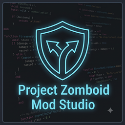
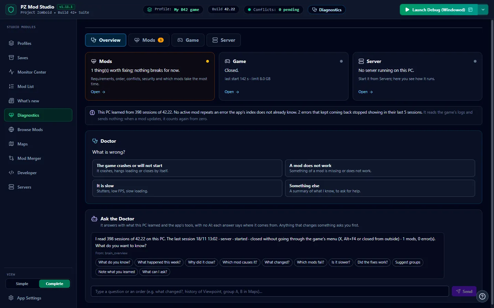
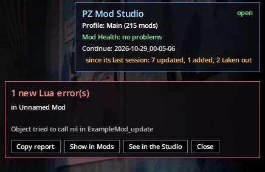

<div align="center">



# PZ Mod Studio

### More mods. Fewer crashes.

**The free mod manager for Project Zomboid (Build 42) that tells you which mod broke your game.**

[](https://opensource.org/licenses/MIT)
[](https://github.com/pzmodstudio/PZModStudio/releases/latest)
[](https://github.com/pzmodstudio/PZModStudio/releases)

[**Download**](https://github.com/pzmodstudio/PZModStudio/releases/latest) • [**Website**](https://pzmodstudio.github.io/PZModStudio/) • [**itch.io**](https://pichu66.itch.io/pzmodstudio) • [**The in-game mod on the Steam Workshop**](https://steamcommunity.com/sharedfiles/filedetails/?id=3824256253)

</div>

---

## What it does for you

PZ Mod Studio reads the game's own log, names the mod behind each error in plain words and, when there is a fix, gives you the button for it. It also backs up your save before changed mods can ruin it.



- **The mod behind every error.** Each error in the game's log becomes a card: which mod, what it means, whether the game carried on, and a report you can send its author.
- **Your list checked the way the game loads it.** Missing or switched-off requirements, a wrong order, mods your build can't load, two mods replacing the same file or the same function. Each finding says whether you need to act, and offers the fix.
- **The Doctor.** Ask "why did my game close?" or "what changed since yesterday?" in your language. It answers from what this PC saw in your own sessions, with the evidence. No AI, and nothing is sent anywhere.
- **Saves you don't lose.** A backup before a save loads with changed mods (made by the app, so keep it open while you play); add the mods you switched on since, or play on a copy.
- **A way back from a bad update.** Steam keeps only the newest version of a Workshop mod. The app can keep the one you played with (it asks first, and says how much space it would use), so an update that breaks your save can be undone.
- **Profiles.** Light, heavy and co-op mod lists side by side; the game's Mods screen follows the active one.
- **Servers.** Install the official dedicated server, restart it on a schedule, after a crash or when a mod updates, with a Discord bot.
- **Simple view** for new players: Play, your mods, and only what needs fixing.
- **In 7 languages:** English, Español, Português (Brasil), Français, Deutsch, Русский, 简体中文.

The free companion mod on the Workshop, **PZ Mod Manager Studio Link**, shows the mod behind each Lua error inside the game and checks every save before it loads.



## Install

**Windows 10 / 11:** download `PZ-Mod-Studio-Portable-v*.zip` from the [latest release](https://github.com/pzmodstudio/PZModStudio/releases/latest) (or [itch.io](https://pichu66.itch.io/pzmodstudio)), unzip it anywhere and run `Project-Zomboid-Mod-Studio.exe`. Nothing is installed and no administrator rights are needed. It finds your game, Steam Workshop and Zomboid folders by itself.

Windows may show a SmartScreen notice the first time, only because the program has no paid code-signing certificate. Each release has a `SHA256SUMS.txt` signed by the project, to check that the file is the one published here. The zip also holds `pz-mcp-server.exe`, a console program for AI assistants: a player can ignore it.

**Linux (beta: new, little used so far):** from the same release, the `.AppImage` (make it executable and run it) or the `.deb` (`sudo apt install ./PZ-Mod-Studio-v*-linux-amd64.deb`). A few extras are Windows-only: updating the app in place (on Linux it opens the release page), subscribing through the Steam client, downloading SteamCMD (install it from your distribution), the Windows out-of-memory log and controlling the game's window for AI assistants.

## Is it safe?

- **Open source (MIT):** every line of the app and of the in-game mod is in this repository.
- **No account, no telemetry, no ads.** It goes online only to browse the Workshop, translate a description when you ask, and look for a new version once a day (you can switch that off).
- **It never edits your Workshop mods.** A fix is a separate mod folder you can delete; your mod list is backed up every time it changes; a save is only changed when you say yes, after a backup.

## How to stop using it

1. Close the app and delete the folder you unzipped (on Linux, the AppImage, or `sudo apt remove project-zomboid-mod-studio`). Your mods and saves stay as they are, and the game keeps your current mod list.
2. If you want to remove everything it made: in your `Zomboid` folder, the folders and files whose name starts with `PZModStudio_` (backups, logs, cache, kept versions), and in `Zomboid/mods` the folders `Z_PZModStudio_*` (patch packages), `PZModStudio_Profiler` (the time measuring, when you used it) and `Z_StudioLink` (its local copy of the in-game mod). Copies of Workshop mods it made for you carry a `.pzms_workshop_copy.json` file inside. On Windows its settings are in `%APPDATA%\PZModStudio`, `%LOCALAPPDATA%\PZModStudio` and `%LOCALAPPDATA%\com.pzmodstudio.app`.
3. Unsubscribe from PZ Mod Manager Studio Link on the Workshop if you had it.

## What is inside (for the curious)

- **Merger:** when two mods replace the same file, it builds a small package that loads last with both changes, using a line-by-line three-way merge (like git's) of the game's file and each mod's; Lua is checked for syntax errors before it is saved. Your mods are not touched.
- **Servers' player list:** names, roles, Steam ids, where a player entered and whether they died, read from the server's logs. The game's logs carry no ping or health, so the app shows none.
- Built with Tauri 2 (Rust) and React. An MCP server lets AI assistants read your logs and mod list ([AGENTS.md](AGENTS.md)).

---


## 🛠️ Building from Source (Developers & Contributors)

### Prerequisites
- [Node.js 22+](https://nodejs.org/)
- [Rust Stable Toolchain](https://rustup.rs/)

### Setup & Run in Development
```bash
# Clone the repository
git clone https://github.com/pzmodstudio/PZModStudio.git
cd PZModStudio

# Install npm dependencies
npm install

# Run the full desktop application in development mode:
npm run tauri dev

# Or build the release binaries:
npm run build:portable
```

---

## 🤖 Connecting AI Agents via MCP

Add this snippet to your assistant's configuration file (e.g. `claude_desktop_config.json`, `mcp.json`, or `.gemini/settings.json`):

```json
{
  "mcpServers": {
    "pz-mod-studio": {
      "command": "C:\\Path\\To\\Project-Zomboid-Mod-Studio\\pz-mcp-server.exe",
      "args": []
    }
  }
}
```

For complete tool documentation, see [**`AGENTS.md`**](AGENTS.md).

---

## 📚 Technical Knowledge Base (`docs/`)

The repository includes a comprehensive, modular 9-chapter wiki detailing Project Zomboid's internal architecture:

- [**01. Engine Architecture, JVM & Kahlua VM**](docs/01-engine-architecture-kahlua-jvm.md)
- [**02. Lua Script Lifecycle & Event Bus**](docs/02-lua-lifecycle-and-events.md)
- [**03. Item Definitions, Crafting & Fluid API (B42)**](docs/03-crafting-items-and-fluids-b42.md)
- [**04. UI Hierarchy, Context Menus & Timed Actions**](docs/04-ui-context-menu-and-timedactions.md)
- [**05. Loot Distribution & Procedural Spawning**](docs/05-loot-distribution-and-spawns.md)
- [**06. ModData Persistence, Networking & Security**](docs/06-networking-moddata-and-security.md)
- [**07. FMOD Audio, JSON Translations & 3D Z-Levels**](docs/07-sound-translations-and-b42-space.md)
- [**08. Crash Diagnostics, VFS & 3-Way Merging**](docs/08-crash-diagnostics-and-vfs.md)
- [**09. Game Process Control & Live IPC Bridge**](docs/09-game-control-and-ipc-bridge.md)

See the [**Documentation Index**](docs/INDEX.md) for full details.

---

## 🤝 Contributing

Contributions are warmly welcomed! Please read [**`CONTRIBUTING.md`**](CONTRIBUTING.md) for details on code style, submitting polyfill rules, and opening Pull Requests.

---

## 📄 License

This project is licensed under the **MIT License** — see the [**`LICENSE`**](LICENSE) file for details.

---

<div align="center">
<i>Project Zomboid is a registered trademark of The Indie Stone. PZ Mod Studio is an unofficial community project.</i>
</div>
